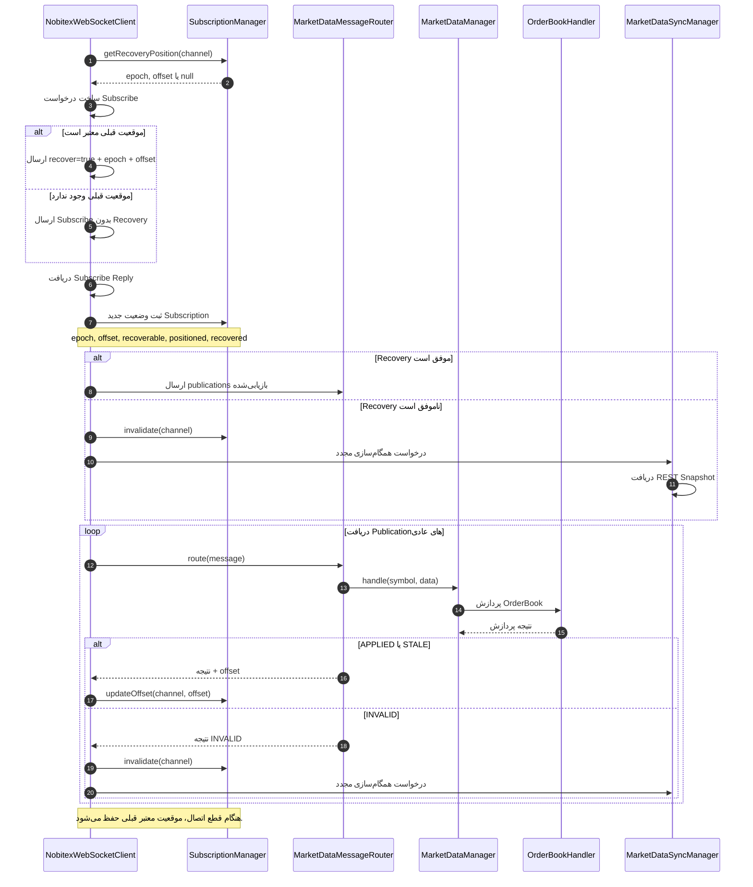

# وضعیت فعلی پروژه و تصمیمات معماری ربات نوبیتکس

## ۱. هدف اصلی پروژه

ساخت یک ربات معاملاتی توسعه‌پذیر برای بازار ارزهای دیجیتال با قابلیت استفاده از استراتژی‌های مختلف.

- بازار فعلی: Nobitex Spot
- بدون معاملات اهرمی و تعهدی
- پشتیبانی از چندین جفت‌ارز به‌صورت هم‌زمان
- قابلیت افزودن بازارها و صرافی‌های دیگر در آینده
- قابلیت استفاده از چند استراتژی مستقل و ترکیبی
- امکان بک‌تست، Paper Trading و ارزیابی عملکرد استراتژی‌ها
- اجرای معاملات واقعی فقط پس از تأیید عملکرد سیستم

## ۲. معماری کلی موردنظر

اجزای اصلی سیستم:

1. Data Provider: دریافت داده از صرافی
2. Market Data Engine: دریافت، پردازش و ذخیره اطلاعات بازار
3. Market Analysis: تحلیل بازار و محاسبه شاخص‌ها
4. Market Regime Detector: تشخیص وضعیت بازار
5. Strategy Engine: اجرای استراتژی‌های مستقل
6. Signal Manager: مدیریت و تجمیع سیگنال‌ها
7. Risk Manager: مدیریت ریسک و سرمایه
8. Simulation / Backtest: شبیه‌سازی معاملات و ارزیابی استراتژی‌ها
9. Execution Engine: اجرای سفارش‌ها در آینده
10. Reporting / Telegram: گزارش وضعیت و ارسال اعلان

معماری باید به‌گونه‌ای باشد که اضافه‌کردن استراتژی جدید یا منبع داده جدید، نیازمند بازنویسی بخش‌های اصلی سیستم نباشد.

## ۳. وضعیت فعلی زیرساخت داده

کلاس‌های موجود:

- NobitexHttpClient
- NobitexWebSocketClient
- MarketDataManager
- MarketDataMessageRouter
- OrderBookHandler
- OrderBookSnapshot
- MarketMetrics
- OrderBookMonitor

### مسئولیت کلاس‌ها

**NobitexWebSocketClient**
- اتصال به WebSocket نوبیتکس
- ارسال Connect و Subscribe
- دریافت پیام‌ها
- مدیریت Heartbeat
- مدیریت قطع اتصال و تلاش مجدد

**MarketDataMessageRouter**
- تشخیص کانال پیام
- استخراج نماد
- انتقال اطلاعات به MarketDataManager

**MarketDataManager**
- نگهداری Handler مستقل برای هر نماد
- مقداردهی اولیه و به‌روزرسانی OrderBook
- جلوگیری از تداخل اطلاعات نمادها

**OrderBookHandler**
- اعتبارسنجی bids و asks
- بررسی ترتیب قیمت‌ها
- کنترل داده‌های نامعتبر
- محاسبه تازگی اطلاعات
- تولید Snapshot

**MarketMetrics**
- محاسبه Spread
- محاسبه Spread Percentage
- محاسبه Imbalance

## ۴. وضعیت فعلی اتصال WebSocket

پروتکل ارتباطی نوبیتکس مبتنی بر Centrifugo است.

مواردی که عملاً مشاهده و تأیید شده‌اند:

- اتصال WebSocket برقرار می‌شود.
- Subscribe به چند کانال انجام می‌شود.
- پاسخ Subscribe شامل recoverable، epoch، offset و positioned است.
- هر کانال موقعیت مستقل دارد.
- پیام‌های OrderBook از طریق push.pub.data دریافت می‌شوند.
- اطلاعات offset در push.pub.offset قرار دارد.
- پیام دریافتی شامل bids، asks، lastTradePrice و lastUpdate است.
- داده دریافتی در نمونه‌های بررسی‌شده OrderBook کامل بوده، نه Delta.
- تنظیم delta:fossil فعال نشده است و فعلاً نباید فعال شود.

هر کانال باید وضعیت Recovery مستقل داشته باشد.

## ۵. مشکل فعلی همگام‌سازی داده

در Command فعلی:

1. دریافت Snapshot همه بازارها از REST
2. مقداردهی اولیه MarketDataManager
3. اتصال WebSocket
4. Subscribe به کانال‌ها
5. شروع دریافت پیام‌ها

این ترتیب ممکن است باعث از دست رفتن تغییرات بین دریافت REST و Subscribe شود.

همچنین هنگام قطع WebSocket:

- MarketDataManager.invalidateAll() اجرا می‌شود.
- اتصال مجدداً برقرار می‌شود.
- Subscribe مجدد انجام می‌شود.
- اما Snapshot جدید دریافت نمی‌شود.
- Recovery واقعی Centrifugo نیز هنوز پیاده‌سازی نشده است.

بنابراین زیرساخت فعلی دریافت داده کار می‌کند، ولی همگام‌سازی اولیه و بازیابی پس از قطع اتصال هنوز کامل نیست.

## ۶. معماری موردنیاز برای Recovery

باید یک سازوکار مستقل برای مدیریت Subscription و همگام‌سازی اطلاعات پیاده‌سازی شود.

### SubscriptionManager

مسئولیت‌ها:

- نگهداری وضعیت مستقل هر کانال
- نگهداری epoch
- نگهداری آخرین offset پردازش‌شده
- نگهداری وضعیت recoverable
- مدیریت وضعیت Recovery
- تشخیص تغییر epoch و نیاز به همگام‌سازی مجدد

### MarketDataSyncManager

مسئولیت‌ها:

- مدیریت همگام‌سازی اولیه REST و WebSocket
- دریافت Snapshot تازه در صورت شکست Recovery
- مدیریت پیام‌های موقت هنگام دریافت Snapshot
- تطبیق Snapshot و پیام‌های دریافتی
- اعلام آماده‌بودن هر بازار پس از همگام‌سازی

### رفتار Recovery

در اتصال مجدد:

1. ارسال Subscribe با recover:true و آخرین epoch و offset همان کانال
2. بررسی پاسخ Subscribe
3. اگر recovered:true بود، پردازش publicationهای بازیابی‌شده
4. اگر recovered:false بود، دریافت Snapshot تازه از REST
5. تا پایان بازیابی، داده بازار معتبر برای تولید سیگنال معاملاتی محسوب نشود.

پیام‌های داخل publications پاسخ Subscribe باید دقیقاً مانند pushهای عادی از مسیر پردازش داده عبور کنند.

### مدیریت Offset

نتیجه پردازش پیام باید مشخص باشد:

- APPLIED: پیام معتبر و اعمال‌شده؛ Offset ثبت شود.
- STALE: پیام معتبر ولی قدیمی؛ اعمال نشود، اما Offset ثبت شود.
- INVALID: پیام نامعتبر؛ Offset ثبت نشود و فرایند بازیابی فعال شود.

ثبت Offset فقط بعد از پردازش و اعتبارسنجی پیام انجام شود.

## ۷. نکات مهم درباره OrderBook

- initialize فعلی امکان جایگزینی اطلاعات جدید با Snapshot قدیمی را دارد؛ باید اصلاح شود.
- پیام فاقد lastUpdate نباید بدون کنترل ترتیب وارد OrderBook شود.
- حفظ lastUpdate هنگام invalidate می‌تواند برای جلوگیری از پذیرش داده قدیمی مفید باشد.
- freshness و ترتیب زمانی داده دو مفهوم مستقل هستند.
- مقایسه lastUpdate در REST و WebSocket باید پس از تأیید یکسان بودن معنای زمانی این فیلد انجام شود.
- داده نامعتبر نباید به‌عنوان داده معتبر در اختیار استراتژی قرار گیرد.

## ۸. تصمیمات معماری قطعی

- Recovery داخل NobitexWebSocketClient به‌صورت پراکنده پیاده‌سازی نشود؛ مدیریت وضعیت کانال مستقل باشد.
- SubscriptionManager داخل MarketDataManager ادغام نشود.
- منطق دریافت REST داخل WebSocket Client قرار نگیرد.
- OrderBookHandler مسئول مدیریت اتصال و Subscription نباشد.
- پیام‌های عادی و Recovery از یک مسیر پردازش عبور کنند.
- وضعیت هر نماد مستقل باشد.
- تا زمان تکمیل همگام‌سازی، بازار برای تحلیل و تولید سیگنال معتبر محسوب نشود.
- تغییرات معماری باید با حفظ تست‌های فعلی انجام شوند.

## ۹. ترتیب ادامه توسعه

1. طراحی و پیاده‌سازی SubscriptionManager
2. اصلاح NobitexWebSocketClient برای مدیریت پاسخ Connect و Subscribe و Recovery
3. اصلاح MarketDataMessageRouter برای پردازش یکپارچه پیام‌ها
4. اصلاح OrderBookHandler و تعریف نتیجه پردازش پیام
5. پیاده‌سازی MarketDataSyncManager
6. اصلاح NobitexOrderBook Command
7. نوشتن تست‌های Recovery، قطع اتصال، تغییر epoch، شکست Recovery و همگام‌سازی REST
8. آزمایش اتصال پایدار با چند نماد

## ۱۰. وضعیت فعلی پروژه و نحوه ادامه کار

- معماری کلی پروژه بررسی شده است.
- کلاس‌های اصلی زیرساخت داده بررسی شده‌اند.
- تست‌های فعلی بخش‌های اصلی OrderBook، MarketDataManager، Router، Metrics و Strategy بررسی شده‌اند.
- Command فعلی و WebSocket Client بررسی شده‌اند.
- مشکل اصلی فعلی، تکمیل همگام‌سازی اولیه و Recovery است.
- هنوز تغییرات مربوط به Recovery پیاده‌سازی نشده‌اند.

### دستورالعمل ادامه پروژه

قبل از هر تغییر کد، ابتدا این سند و وضعیت ثبت‌شده پروژه مبنا قرار گیرد.

از بررسی مجدد فایل‌هایی که قبلاً بررسی شده‌اند خودداری شود، مگر اینکه نسخه آن‌ها تغییر کرده یا برای تصمیم مشخصی واقعاً نیاز به بررسی باشد.

دستیار باید نقش معمار و مدیر فنی پروژه را بر عهده بگیرد، تصمیم‌های معماری را یکپارچه کند و از درخواست مکرر فایل‌ها، تغییرات پراکنده و بازنویسی غیرضروری جلوگیری کند.

تغییرات باید مرحله‌بندی‌شده، همراه با تست و با حفظ سازگاری بخش‌های موجود انجام شوند.

هدف، پیشرفت واقعی پروژه است؛ نه تکرار بررسی‌ها و تولید مداوم طرح‌های جدید.

# قرارداد ارتباطی WebSocket و SubscriptionManager

## UML Sequence Diagram

